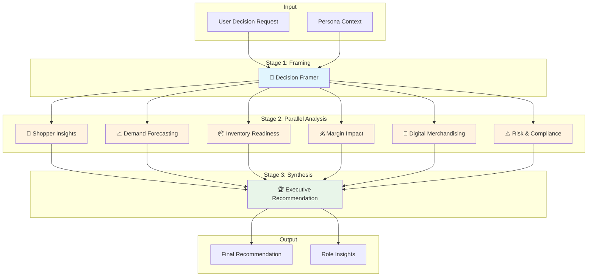
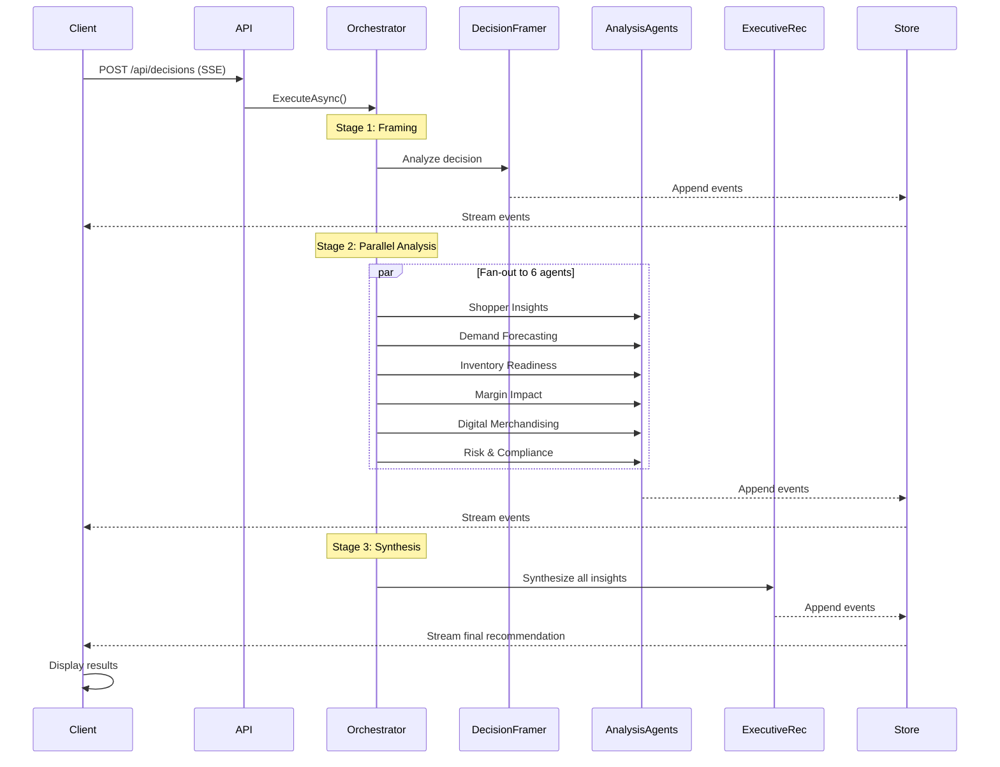

# Retail Intelligence Studio

A multi-agent AI system for retail decision intelligence, built with .NET Aspire and Microsoft Agent Framework. The system orchestrates specialized AI agents to analyze business decisions from multiple perspectives, providing comprehensive insights for retail executives.


## 🎯 Overview

Retail Intelligence Studio uses a **fan-out/fan-in orchestration pattern** to evaluate business decisions through 8 specialized intelligence agents. Each agent analyzes the decision from a unique perspective, and the results are synthesized into an executive recommendation.

### Key Features

- **Multi-Agent Architecture**: 8 specialized AI agents working in concert
- **Parallel Execution**: 6 analysis agents run concurrently for fast insights
- **Real-time Streaming**: Server-Sent Events (SSE) for live progress updates
- **Persona-Based Context**: Tailored analysis for different retail segments
- **Observable**: Full OpenTelemetry integration with Aspire Dashboard

## 🏗️ Architecture

### Agent Workflow



### Orchestration Flow



## 🤖 Intelligence Agents

### Stage 1: Decision Framing

| Agent | Purpose | Output |
|-------|---------|--------|
| **🎯 Decision Framer** | Clarifies the business question and produces a structured Decision Brief. Identifies the core question, proposed action, scope, and key assumptions. | Decision Brief |

### Stage 2: Parallel Analysis

| Agent | Purpose | Focus Areas |
|-------|---------|-------------|
| **👥 Shopper Insights** | Analyzes customer behavior, preferences, and potential reactions to the proposed decision. | Customer Segments, Purchase Patterns, Price Sensitivity, Brand Loyalty |
| **📈 Demand Forecasting** | Projects demand impact and volume changes resulting from the decision. | Volume Projections, Seasonality, Trend Analysis, Cannibalization |
| **📦 Inventory Readiness** | Evaluates supply chain and inventory implications. | Stock Levels, Lead Times, Supplier Capacity, Distribution |
| **💰 Margin Impact** | Calculates financial implications including margin, revenue, and profitability. | Gross Margin, Revenue Impact, Cost Analysis, ROI |
| **🛒 Digital Merchandising** | Assesses e-commerce and digital channel considerations. | Online Conversion, Search Visibility, Digital Placement, Omnichannel |
| **⚠️ Risk & Compliance** | Identifies risks, regulatory concerns, and potential compliance issues. | Regulatory Risk, Brand Risk, Operational Risk, Mitigation Strategies |

### Stage 3: Synthesis

| Agent | Purpose | Output |
|-------|---------|--------|
| **🏆 Executive Recommendation** | Synthesizes all analysis perspectives into a final recommendation with confidence score, key factors, and action items. | Executive Summary with Verdict (PROCEED / PROCEED WITH CAUTION / DO NOT PROCEED) |

## 🚀 Getting Started

### Prerequisites

- [.NET SDK 10.0.404](https://dotnet.microsoft.com/download) (`global.json`; targets remain `net10.0`)
- [Aspire CLI 17.0.0 bundle](https://aspire.dev/get-started/aspire-sdk/) on the process-local `PATH`
- [Node.js 26.13.0](https://nodejs.org/) and npm 11.20.0 (after resolving the lockfile hold below)
- [Docker Desktop](https://www.docker.com/products/docker-desktop/) (optional, for containerized deployment)
- [Azure CLI](https://docs.microsoft.com/cli/azure/install-azure-cli) (optional, for Azure OpenAI with Entra ID authentication)

### Dependency refresh status (2026-11-18)

The earlier non-Aspire dependency refresh used the configured approved feed,
`https://packagefeedproxy.microsoft.io/nuget/v3/index.json`. The Aspire 17 source
migration and **local compile validation** are now complete using the separately
verified source below, not signed production NuGet packages.

| Direct dependency | Before | After |
|---|---|---|
| Aspire AppHost SDK / JavaScript | 13.1.0 | Standard .NET SDK; explicit AppHost / Dotnet / JavaScript 17.0.0 |
| Aspire.Hosting.NodeJs | 9.5.2 | Removed; supported JavaScript integration replaces it |
| Microsoft.Agents.AI / AI.Abstractions / AI.OpenAI | 1.0.0-preview.260121.1 | 1.28.0 stable |
| Microsoft.Extensions.AI / AI.Abstractions | 10.2.0 | 11.0.0 |
| Azure.Identity / Azure.AI.OpenAI | 1.14.2 / 2.1.0 | 1.21.0 / 2.1.0 (newest stable) |
| ASP.NET OpenAPI / SpaServices.Extensions | 10.0.1 | 10.0.15 |
| Microsoft.Extensions.Http.Resilience / ServiceDiscovery | 10.1.0 | 11.0.0 |
| OpenTelemetry OTLP / hosting | 1.15.0 | 1.21.0 |
| OpenTelemetry ASP.NET / HTTP / runtime | 1.12.0 | 1.21.0 |
| Microsoft.Extensions.Hosting / System.Text.Json | 10.0.0 | 11.0.0 |
| YamlDotNet | 16.3.0 | 18.1.0 |
| Microsoft.NET.Test.Sdk / coverlet.collector | 17.14.1 / 6.0.4 | 18.12.0 / 10.1.0 |
| Moq / FluentAssertions / xunit.runner.visualstudio | 4.20.72 / 7.2.0 / 3.1.4 | 4.21.0 / 8.11.0 / 4.0.1 |
| xunit | 2.9.3 | Unchanged: newest stable version on the feed |

**Exact holds and unfinished work:**

- **Aspire 17.0.0 is not on the approved feed.** The SDK, AppHost and
  JavaScript indexes have no `17.0.0`; `Aspire.Hosting.Dotnet` has no stable
  version there, and `Aspire.Cli` also lacks `17.0.0`. Normal feed/CI restore is
  still blocked. Following the [official migration](https://aspire.dev/integrations/dotnet/migrate-dotnet-project-resource/),
  AppHost now uses `Microsoft.NET.Sdk`, explicit AppHost/Dotnet/JavaScript 17.0.0,
  and `AddDotnetProject("server", "../RetailIntelligenceStudio.Server/RetailIntelligenceStudio.Server.csproj")`.
  The former project reference existed solely for orchestration metadata and was
  removed; the server remains in the solution and was built separately.
  The default `Path` CLI selection uses a matching 17.0.0 dashboard/DCP bundle.
  No global tool, SDK or workload installation was performed.
- ASP.NET 11 is `net11.0`-only, so 10.0.15 remains the newest compatible
  stable line. Updated Extensions 11 packages support `net10.0`.
- **All npm ranges and the frontend lockfile are unchanged.** Offline
  inspection found **486** public-registry resolved URLs in
  `frontend/package-lock.json`, although the effective registry is
  `https://packagefeedproxy.microsoft.io/npm/`. Proxy metadata was checked,
  but no npm install/ci, build, lint or test was run. Supply an authoritative
  proxy-only lockfile or explicitly approve regeneration before installation.
  Never fetch or silently replace the existing URLs. All npm instructions
  below are conditional on resolving this hold.

Use ONLY `https://packagefeedproxy.microsoft.io/npm/` for npm-family package traffic.
Never contact `registry.npmjs.org`, including probes, direct downloads, redirects,
or lockfile-resolved tarball URLs. No public-registry overrides or fallbacks,
including environment variables, scoped registry settings, or alternate configuration
files. Inspect the effective registry and lockfiles offline before install/ci.
If IT policy blocks a request, stop immediately without even one retry.

The frontend resource remains `webfrontend`, using the same `dev` script,
server reference, HTTP port 5173/`PORT` binding and external endpoint.
`AddJavaScriptApp` replaces `AddNpmApp`; JavaScript's built-in Dockerfile
publishing replaces the obsolete NodeJs publishing extension, with an explicit
`build` script. Automatic npm
installation is disabled so starting the AppHost cannot install the unsafe
historical lockfile. Install frontend dependencies separately only after
the registry/lockfile hold is resolved.

**Exact local Aspire validation source:**

- Official [17.0.0 CLI release](https://github.com/microsoft/aspire/releases/tag/v17.0.0),
  commit `2d325b13709752ba6d9a943635c5e2940a2530c0`. Windows x64 archive SHA-512
  sidecar and extracted executable's Authenticode signature verified; archive SHA-256
  `3d88b09be9cd3d344323b2e3531280954953581adb8102ad50eaf23c67007c05`.
- Same-commit [GitHub CI run 44203911604](https://github.com/microsoft/aspire/actions/runs/44203911604),
  `built-nugets` artifact **14382652960**, archive SHA-256
  `6e522a103ff37924122e9ebea3a8bf33f21b3349e11e0b59bc86ac51cc2a15aa`.
  These are **unsigned Debug CI NuGet packages**, version 17.0.0, for local
  development/API/compile validation only, not signed production verification.

An external, uncommitted NuGet config mapped `Aspire.*` to that local artifact and
other packages to the approved proxy. Repository-specific `NUGET_PACKAGES` and
`ASPIRE_HOME`, with the signed CLI prepended to process-local `PATH`, isolated the run.
The existing global package cache was a read-only restore fallback. No global settings
changed and no expiring artifact URL is stored in this repository.

**No CI-derived Aspire lock is included in candidate changes.** Unsigned Debug
CI packages and signed Release packages have **different content hashes even at
the same 17.0.0 ID/version**. The development-only AppHost lock was moved into the
external repository-specific validation cache. Further local artifact restores
must use `-p:NuGetLockFilePath=<isolated-validation-cache>\apphost-validation.lock.json`.
Generate a release AppHost lock only against approved signed packages when mirrored,
then validate it before enabling AppHost locked-mode CI. Obsolete untracked interim
Windows/Linux locks were removed with NuGet dashboard/DCP dependencies.

There are no pre-existing tracked NuGet locks needing signed-package regeneration.
Existing non-Aspire backend/test locks and their enforcement are unchanged. No
machine paths or source URLs are embedded in candidate locks.

Final targeted commands used `DOTNET_CLI_WORKLOAD_UPDATE_NOTIFY_DISABLE=true`,
`DOTNET_SKIP_FIRST_TIME_EXPERIENCE=true`, and `-m:1 -nr:false`:

| Target | Final result |
|---|---|
| `RetailIntelligenceStudio.AppHost\RetailIntelligenceStudio.AppHost.csproj` | Aspire 17 restore, development-only locked restore and `dotnet build --no-restore` succeeded, 0 warnings/errors |
| `RetailIntelligenceStudio.Tests\RetailIntelligenceStudio.Tests.csproj` | Locked restore and `dotnet test --no-restore` succeeded: **135 passed, 0 failed, 0 skipped** |
| `RetailIntelligenceStudio.Server\RetailIntelligenceStudio.Server.csproj` | Locked restore and `dotnet build --no-restore` succeeded, 0 warnings/errors |

Each restore used `--configfile <external-validation-config>`
`-p:RestoreFallbackFolders=<existing-global-package-cache>`. Prior interim
13.6.5 solution/Linux-restore results are superseded; no Linux build was run here.
No duplicate logging-generator error occurred, so no generator workaround was added.
AppHost execution, dashboard behavior, frontend compatibility and publishing remain
unverified. No application servers, containers, desktop services or Azure resources
were started, and no workflow or deployment was run.

### Running Locally

1. **Clone the repository**
   ```bash
   git clone https://github.com/yourusername/retail-intelligence-studio.git
   cd retail-intelligence-studio
   ```

2. **Trust the development certificate** (first time only)
   ```bash
   dotnet dev-certs https --trust
   ```

3. **Start the application** (only after the feed/lockfile holds above are resolved
   and the matching signed CLI bundle is on your process-local `PATH`)
   ```bash
   dotnet run --project RetailIntelligenceStudio.AppHost
   ```

4. **Open the application**
   - **Aspire Dashboard**: https://localhost:17204 (login token shown in console)
   - **Frontend**: The URL will be shown in the Aspire Dashboard

> **Note**: Without Azure OpenAI configuration, the application runs with local mock agents that return simulated responses. This is great for UI development and testing the workflow.

### Configuration

## 🔐 Azure OpenAI Setup

The application supports two authentication methods for Azure OpenAI:

### Option 1: API Key Authentication (Simplest)

1. **Get your Azure OpenAI credentials** from the [Azure Portal](https://portal.azure.com):
   - Navigate to your Azure OpenAI resource
   - Go to **Keys and Endpoint**
   - Copy the **Endpoint** and one of the **Keys**

2. **Configure the application** - Create or edit `RetailIntelligenceStudio.Server/appsettings.Development.json`:

   ```json
   {
     "AzureOpenAI": {
       "Endpoint": "https://your-resource.openai.azure.com/",
       "DeploymentName": "gpt-4o",
       "ApiKey": "your-api-key-here"
     }
   }
   ```

   > ⚠️ **Security Note**: Never commit API keys to source control. The `appsettings.Development.json` file is included in `.gitignore`.

3. **Alternative: Use environment variables**:
   ```bash
   # PowerShell
   $env:AzureOpenAI__Endpoint = "https://your-resource.openai.azure.com/"
   $env:AzureOpenAI__DeploymentName = "gpt-4o"
   $env:AzureOpenAI__ApiKey = "your-api-key-here"
   
   # Bash
   export AzureOpenAI__Endpoint="https://your-resource.openai.azure.com/"
   export AzureOpenAI__DeploymentName="gpt-4o"
   export AzureOpenAI__ApiKey="your-api-key-here"
   ```

### Option 2: Entra ID Authentication (Recommended for Production)

This method uses `DefaultAzureCredential` which supports multiple authentication flows including Azure CLI, Visual Studio, and managed identities.

1. **Login to Azure CLI**:
   ```bash
   az login
   ```

2. **Ensure you have the required RBAC role** on your Azure OpenAI resource:
   - Role: **Cognitive Services OpenAI User** (or Contributor)
   - Assign via Azure Portal or CLI:
     ```bash
     az role assignment create \
       --role "Cognitive Services OpenAI User" \
       --assignee your-email@domain.com \
       --scope /subscriptions/{subscription-id}/resourceGroups/{resource-group}/providers/Microsoft.CognitiveServices/accounts/{openai-resource-name}
     ```

3. **Configure the endpoint** (no API key needed):
   ```json
   {
     "AzureOpenAI": {
       "Endpoint": "https://your-resource.openai.azure.com/",
       "DeploymentName": "gpt-4o"
     }
   }
   ```

### Azure OpenAI Requirements

| Requirement | Details |
|-------------|---------|
| **Model Deployment** | You need a deployed model (e.g., `gpt-4o`, `gpt-4`, `gpt-35-turbo`) in your Azure OpenAI resource |
| **API Version** | The application uses the latest Azure OpenAI SDK which handles API versioning automatically |
| **Region** | Ensure your Azure OpenAI resource is in a region that supports your chosen model |

### Troubleshooting

| Error | Cause | Solution |
|-------|-------|----------|
| `400 BadRequest` | Invalid endpoint, missing deployment, or auth failure | Verify endpoint URL and deployment name exist |
| `401 Unauthorized` | Invalid API key or missing RBAC permissions | Check API key or run `az login` and verify RBAC role |
| `403 Forbidden` | Subscription/resource access denied | Verify your account has access to the Azure OpenAI resource |
| `404 NotFound` | Deployment name doesn't exist | Verify the model deployment name in Azure Portal |
| `DefaultAzureCredential` error | Not logged into Azure CLI | Run `az login` to authenticate |

### Configuration Reference

| Setting | Environment Variable | Description | Required |
|---------|---------------------|-------------|----------|
| `AzureOpenAI:Endpoint` | `AzureOpenAI__Endpoint` | Azure OpenAI endpoint URL | Yes |
| `AzureOpenAI:DeploymentName` | `AzureOpenAI__DeploymentName` | Model deployment name | No (default: `gpt-4o`) |
| `AzureOpenAI:ApiKey` | `AzureOpenAI__ApiKey` | API key for authentication | No (uses Entra ID if not set) |

## 📁 Project Structure

```
retail-intelligence-studio/
├── RetailIntelligenceStudio.AppHost/     # Aspire orchestration host
├── RetailIntelligenceStudio.ServiceDefaults/  # Shared service configuration
├── RetailIntelligenceStudio.Server/      # ASP.NET Core API backend
├── RetailIntelligenceStudio.Core/        # Domain models and abstractions
├── RetailIntelligenceStudio.Agents/      # Intelligence agents and orchestration
│   ├── Roles/                            # Individual agent implementations
│   ├── Orchestration/                    # Workflow orchestrator
│   └── Infrastructure/                   # Agent factories and clients
├── RetailIntelligenceStudio.Tests/       # Unit and integration tests
└── frontend/                             # React 19 + Vite frontend
```

## 🔭 Observability

The application includes full OpenTelemetry instrumentation:

- **Traces**: Distributed tracing across all agent executions
- **Metrics**: Runtime and HTTP metrics
- **Structured Logs**: Rich logging with emoji prefixes for easy scanning

View all telemetry in the Aspire Dashboard at https://localhost:17204.

## 🧪 Testing

Run all tests:
```bash
dotnet test
```

Run specific test categories:
```bash
dotnet test --filter "OpenTelemetryLoggingTests"
```

## 🛠️ Technology Stack

| Layer | Technology |
|-------|------------|
| **Orchestration** | Aspire 17.0.0 (local compile validated; signed NuGet feed blocked) |
| **Backend** | ASP.NET Core 10 |
| **AI Framework** | Microsoft Agent Framework |
| **Frontend** | React 19, Vite 6, TailwindCSS |
| **Observability** | OpenTelemetry, Aspire Dashboard |
| **AI Provider** | Azure OpenAI (or local mock) |

## 📄 License

This project is licensed under the MIT License - see the [LICENSE](LICENSE) file for details.

## 🤝 Contributing

Contributions are welcome! Please feel free to submit a Pull Request.

1. Fork the repository
2. Create your feature branch (`git checkout -b feature/amazing-feature`)
3. Commit your changes (`git commit -m 'Add some amazing feature'`)
4. Push to the branch (`git push origin feature/amazing-feature`)
5. Open a Pull Request
